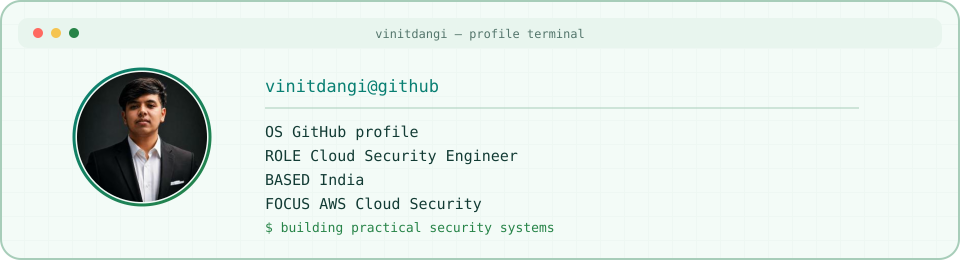
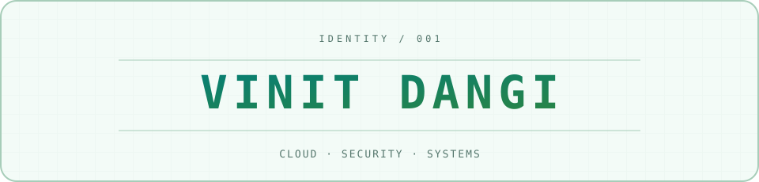
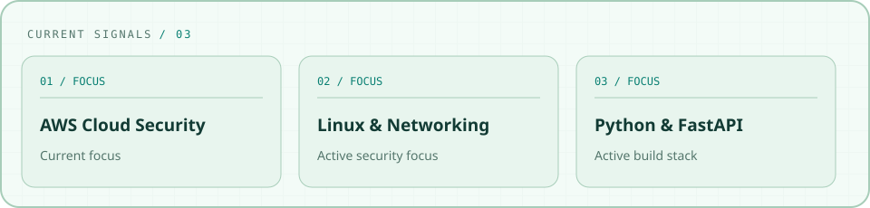
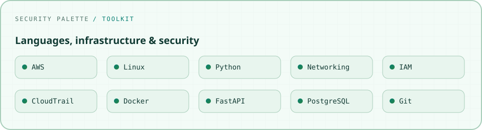
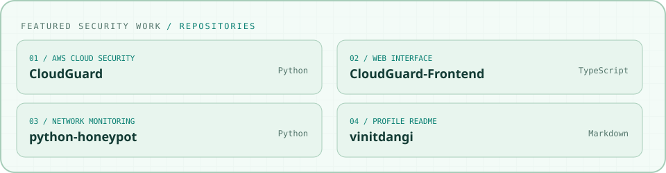
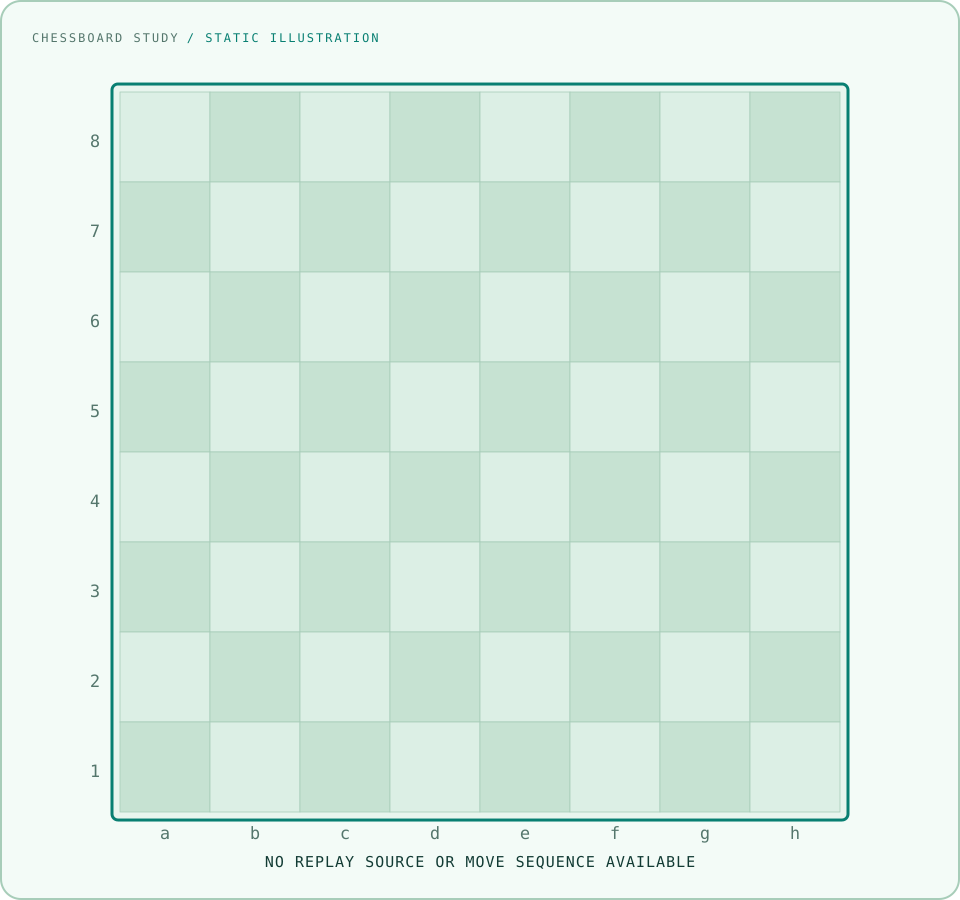
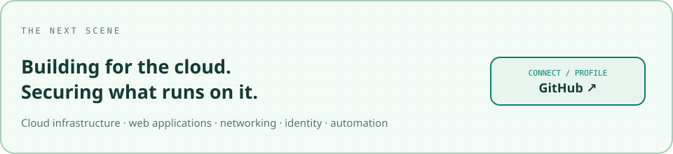

<!-- TOP PROFILE CARD -->
<picture>
  <source media="(prefers-color-scheme: light)" srcset="assets/neofetch-light.svg" />
  <source media="(prefers-color-scheme: dark)" srcset="assets/neofetch-dark.svg" />
  
</picture>

<!-- NAME UNDER PROFILE -->
<picture>
  <source media="(prefers-color-scheme: light)" srcset="assets/wordmark-light.svg" />
  <source media="(prefers-color-scheme: dark)" srcset="assets/wordmark-dark.svg" />
  
</picture>

<!-- ORANGE GITHUB LINK -->

  

─────── ◇ ───────

<table width="100%" style="display:table;width:100%;table-layout:fixed;">
<tr>

<td width="58%" valign="top">

<h2>The point of view</h2>

<blockquote>
Building practical security systems for cloud and web environments.
</blockquote>

BCA student focused on Cloud Security and Cybersecurity, building practical security tools and developing skills across AWS, Linux, networking, identity, monitoring, and security automation.

</td>

<td width="42%" valign="top">

<code>PROFILE</code>

ROLE · Cloud Security Engineer 
BASED · India 
FOCUS · AWS Cloud Security

<strong>7+</strong> repos 
<strong>Security</strong> focused 
<strong>AWS</strong> cloud

</td>

</tr>
</table>

─────── ◇ ───────

<h2>In the current cut</h2>

<picture>
  <source media="(prefers-color-scheme: light)" srcset="assets/highlights-light.svg" />
  <source media="(prefers-color-scheme: dark)" srcset="assets/highlights-dark.svg" />
  
</picture>

AWS security · Linux & networking · Python security automation

─────── ◇ ───────

<h2>Security palette</h2>

<picture>
  <source media="(prefers-color-scheme: light)" srcset="assets/stack-light.svg" />
  <source media="(prefers-color-scheme: dark)" srcset="assets/stack-dark.svg" />
  
</picture>

AWS · Linux · Python · Networking · IAM · CloudTrail · Docker · FastAPI · PostgreSQL · Git

─────── ◇ ───────

<h2>Featured security work</h2>

<picture>
  <source media="(prefers-color-scheme: light)" srcset="assets/projects-light.svg" />
  <source media="(prefers-color-scheme: dark)" srcset="assets/projects-dark.svg" />
  
</picture>

<table width="100%">
<tr>

<td width="33%" valign="top">

<strong>
<a href="https://github.com/vinitdangi/CloudGuard">CloudGuard</a>
</strong>

AWS Cloud Security Misconfiguration Detection & Risk Assessment Platform.

AWS · IAM · S3 · CloudTrail · FastAPI · PostgreSQL

</td>

<td width="33%" valign="top">

<strong>WebSentinel</strong>

Automated Security Audit System for Websites.

Python · FastAPI · API Security · BOLA / IDOR

</td>

<td width="33%" valign="top">

<strong>
<a href="https://github.com/vinitdangi/python-honeypot">Python Honeypot</a>
</strong>

Security monitoring system for detecting and logging unauthorized access attempts.

Python · Linux · Network Security

</td>

</tr>
</table>

─────── ◇ ───────

<h2>Contribution trail</h2>

<picture>
  <source media="(prefers-color-scheme: light)" srcset="assets/contribution-snake-light.svg" />
  <source media="(prefers-color-scheme: dark)" srcset="assets/contribution-snake-dark.svg" />
  
</picture>

<h2>Play the next move</h2>

<picture>
  <source media="(prefers-color-scheme: light)" srcset="assets/chess-light.svg" />
  <source media="(prefers-color-scheme: dark)" srcset="assets/chess-dark.svg" />
  
</picture>

─────── ◇ ───────

THE NEXT SCENE

<h2>Building for the cloud. Securing what runs on it.</h2>

I build practical security projects around cloud infrastructure,
web applications, networking, identity, and automation.

<picture>
  <source media="(prefers-color-scheme: light)" srcset="assets/social-light.svg" />
  <source media="(prefers-color-scheme: dark)" srcset="assets/social-dark.svg" />
  
</picture>

<a href="https://github.com/vinitdangi">GitHub</a>

vinitdangi · cinematic security profile

