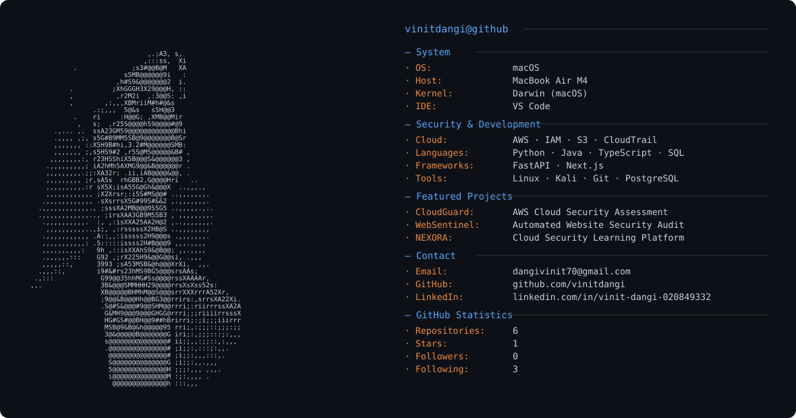
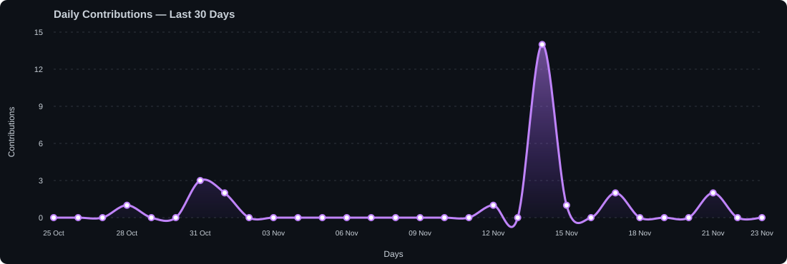

 

<picture>
  <source media="(prefers-color-scheme: dark)" srcset="dark_mode.svg" />
  <source media="(prefers-color-scheme: light)" srcset="light_mode.svg" />
  
</picture>

  

<picture>
  <source media="(prefers-color-scheme: dark)" srcset="https://raw.githubusercontent.com/vinitdangi/vinitdangi/output/snake-dark.svg" />
  <source media="(prefers-color-scheme: light)" srcset="https://raw.githubusercontent.com/vinitdangi/vinitdangi/output/snake-light.svg" />
  
</picture>

  

 

<picture>
  <source media="(prefers-color-scheme: dark)" srcset="https://github-readme-streak-stats-eight.vercel.app/?user=vinitdangi&hide_border=true&background=0A101F&stroke=22D3EE&ring=A78BFA&fire=10B981&currStreakLabel=22D3EE&sideLabels=94A3B8&currStreakNum=F8FAFC&sideNums=F8FAFC&dates=64748B&titleColor=22D3EE&card_width=1180" />
  <source media="(prefers-color-scheme: light)" srcset="https://github-readme-streak-stats-eight.vercel.app/?user=vinitdangi&hide_border=true&background=0A101F&stroke=22D3EE&ring=A78BFA&fire=10B981&currStreakLabel=22D3EE&sideLabels=94A3B8&currStreakNum=F8FAFC&sideNums=F8FAFC&dates=64748B&titleColor=22D3EE&card_width=1180" />
  
</picture>

<picture>
  <source media="(prefers-color-scheme: dark)" srcset="https://github-stats-extended.vercel.app/api?username=vinitdangi&show_icons=true&count_private=true&include_all_commits=true&hide_rank=true&hide_border=true&title_color=22D3EE&icon_color=A78BFA&text_color=94A3B8&bg_color=0A101F&card_width=500" />
  <source media="(prefers-color-scheme: light)" srcset="https://github-stats-extended.vercel.app/api?username=vinitdangi&show_icons=true&count_private=true&include_all_commits=true&hide_rank=true&hide_border=true&title_color=0F172A&icon_color=7C3AED&text_color=475569&bg_color=FFFFFF&card_width=500" />
  
</picture>

<picture>
  <source media="(prefers-color-scheme: dark)" srcset="https://github-stats-extended.vercel.app/api/top-langs/?username=vinitdangi&layout=compact&langs_count=8&hide_border=true&title_color=22D3EE&text_color=94A3B8&bg_color=0A101F&card_width=500" />
  <source media="(prefers-color-scheme: light)" srcset="https://github-stats-extended.vercel.app/api/top-langs/?username=vinitdangi&layout=compact&langs_count=8&hide_border=true&title_color=0F172A&text_color=475569&bg_color=FFFFFF&card_width=500" />
  
</picture>

  

  

&nbsp;&nbsp;

&nbsp;&nbsp;

---

## About

I am a **BCA student at CGC University, Mohali**, focused on **Cloud Security, Network Security, and Application Security**. I build practical security-focused projects to understand how cloud infrastructure and web applications can be assessed, monitored, and secured.

My current development work combines **Python, JavaScript/TypeScript, backend engineering, AWS security concepts, Linux, and web security testing**. I am working toward a career in **Cloud Security Engineering**.

### Engineering Focus

* Cloud Security & AWS Security Posture Assessment
* IAM, S3, Security Groups, Network ACLs & CloudTrail
* Network Security Fundamentals
* Web Application Security
* Authentication, Authorization & BOLA/IDOR Testing
* Python, FastAPI & Backend Development
* API Security & Automated Security Testing
* Linux, Git, Cloud Infrastructure & Security Labs

### Open To

**Cloud Security Internships • Network Security Opportunities • Application Security Projects • Open Source Collaboration**

---

## Tech Stack

### Languages

### Frontend

### Backend & Databases

### Cloud, DevOps & Tooling

### Security Lab

---

## Security & Engineering Focus

| Domain               | Current Focus       | Practical Work                                                     |
| -------------------- | :-----------------: | ------------------------------------------------------------------ |
| Cloud Security       | Hands-on            | AWS security posture checks across IAM, S3, network controls and logging |
| Application Security | Hands-on            | Authenticated attack-surface discovery and authorization testing   |
| API Security         | Learning & building | Authentication, session handling and access-control validation     |
| Network Security     | Learning            | Network fundamentals, segmentation and traffic controls            |
| Backend Engineering  | Hands-on            | Python, FastAPI, PostgreSQL and API design                         |
| Linux & Tooling      | Hands-on            | Linux environments, Git, VirtualBox and security labs              |

---

## Featured Projects

<strong>01 · CloudGuard — AWS Cloud Security Assessment</strong>

 

A cloud security posture assessment platform designed to identify AWS configuration risks and present actionable security findings.

| Dimension      | Details                                                |
| -------------- | ------------------------------------------------------ |
| **Stack**      | Next.js • FastAPI • PostgreSQL • SQLAlchemy • Redis    |
| **Scope**      | AWS security posture assessment                        |
| **Checks**     | IAM • S3 • Security Groups • Network ACLs • CloudTrail |
| **Output**     | Security posture score and PDF assessment reports      |
| **Focus**      | Cloud configuration visibility and risk assessment     |
| **Repository** | [View on GitHub](https://github.com/vinitdangi)        |

### Engineering Perspective

CloudGuard focuses on translating AWS configuration data into evidence-backed security findings. The project covers cloud resource verification, security checks, backend processing, and report generation.

 

<strong>02 · WebSentinel — Automated Website Security Audit</strong>

 

An automated website security audit system focused on discovering attack surfaces and assessing authorization weaknesses with evidence-first findings.

| Dimension        | Details                                                          |
| ---------------- | ---------------------------------------------------------------- |
| **Stack**        | Python • FastAPI • HTTPX • Pydantic                              |
| **Scope**        | Website security assessment                                      |
| **Capabilities** | Authenticated discovery • Authorization mapping • Two-identity comparison |
| **Assessment**   | BOLA/IDOR-oriented access-control testing                        |
| **Output**       | Evidence-backed findings and PDF reporting                       |
| **Focus**        | Reliable detection and reducing false positives                  |
| **Repository**   | [View on GitHub](https://github.com/vinitdangi)                  |

### Engineering Perspective

WebSentinel is being developed with an emphasis on reproducible security testing, clear evidence, and validation across two identities rather than relying on superficial vulnerability signals.

 

<strong>03 · NEXORA — Cloud Security Learning Platform</strong>

 

An educational cloud security simulation and learning platform designed to help learners understand cloud security concepts through guided practical workflows.

| Dimension      | Details                                                  |
| -------------- | -------------------------------------------------------- |
| **Stack**      | Web Development • Cloud Security Concepts                |
| **Scope**      | Educational cloud security simulation                    |
| **Focus**      | Learning cloud security concepts through practical scenarios |
| **Purpose**    | Make cloud security concepts easier to explore           |
| **Repository** | [View on GitHub](https://github.com/vinitdangi)          |

### Engineering Perspective

NEXORA is an academic project centered on explaining and exploring cloud security concepts in a structured learning environment.

---

## Experience

### BCA Student · Security Project Developer

**Current Focus**

**Project Development Scope**

Building practical projects across **cloud security, application security, backend development, and security testing**.

* Developing CloudGuard to assess AWS security configurations.
* Developing WebSentinel for automated website security assessment.
* Practicing Python, backend development, Linux and security testing.
* Using hands-on labs to strengthen networking and application-security fundamentals.
* Applying secure engineering practices through implementation, testing and documentation.
* Continuously developing programming, networking, Linux and security skills through practical work.

**Skills:** `Python` `Java` `JavaScript` `TypeScript` `AWS` `FastAPI` `PostgreSQL` `Linux` `Web Security` `Network Security`

---

## Achievements

|            Recognition            | Details                                                                                       |
| :-------------------------------: | --------------------------------------------------------------------------------------------- |
|   **Security Project Portfolio**  | Developing CloudGuard and WebSentinel as hands-on security engineering projects               |
|    **Cloud Security Learning**    | Practicing AWS security posture assessment and cloud configuration analysis                   |
| **Application Security Focus**    | Exploring authenticated attack-surface discovery and access-control testing                   |
|     **Continuous Learning**       | Developing programming, networking, Linux and security skills through practical work          |

---

## Contribution Activity

---

### `Build securely. Engineer with evidence. Keep learning.`

 

